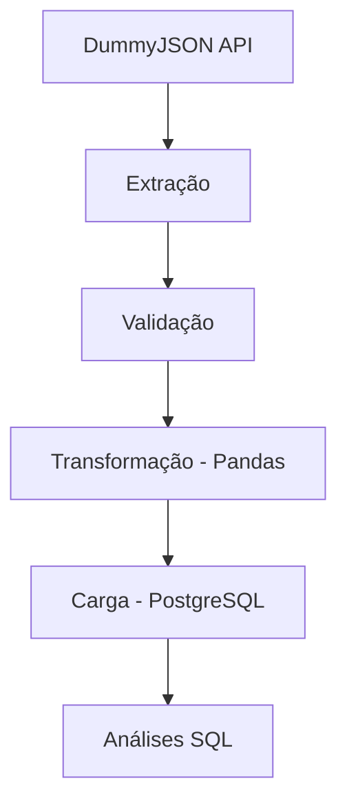

# SalesFlow ETL

Pipeline de dados desenvolvida em Python para extrair dados comerciais de uma API, validar e transformar os dados e carregá-los em um banco de dados PostgreSQL.

O projeto utiliza dados da DummyJSON e tem como objetivo demonstrar um fluxo simples de engenharia de dados (ETL).

# Fluxo



### 3. Visualização

<box border radius="xl" padding=3 gap=2>
  <text weight="medium" textAlign="center">SalesFlow ETL</text>
  <box background="#E0F2FE" theme="light" radius="lg" padding=3 align=center>
    <text color="#075985" weight="medium">DummyJSON API</text>
    <caption color="#075985">Fonte dos dados</caption>
  </box>
  <box align=center>
    <icon name="arrow-down" color="secondary" size="xl"/>
  </box>
  <box background="#E0F2FE" theme="light" radius="lg" padding=3 align=center>
    <text color="#075985" weight="medium">Extração</text>
  </box>
  <box align=center>
    <icon name="arrow-down" color="secondary" size="xl"/>
  </box>
  <box background="#FEF3C7" theme="light" radius="lg" padding=3 align=center>
    <text color="#92400E" weight="medium">Validação</text>
  </box>
  <box align=center>
    <icon name="arrow-down" color="secondary" size="xl"/>
  </box>
  <box background="#FEF3C7" theme="light" radius="lg" padding=3 align=center>
    <text color="#92400E" weight="medium">Transformação</text>
    <caption color="#92400E">Pandas</caption>
  </box>
  <box align=center>
    <icon name="arrow-down" color="secondary" size="xl"/>
  </box>
  <box background="#DCFCE7" theme="light" radius="lg" padding=3 align=center>
    <text color="#166534" weight="medium">Carga</text>
    <caption color="#166534">PostgreSQL</caption>
  </box>
  <box align=center>
    <icon name="arrow-down" color="secondary" size="xl"/>
  </box>
  <box background="#DCFCE7" theme="light" radius="lg" padding=3 align=center>
    <text color="#166534" weight="medium">Análises SQL</text>
  </box>
</box>

<caption>Representação ilustrativa do fluxo ETL.</caption>

## Tecnologias

- Python
- Pandas
- PostgreSQL
- SQLAlchemy
- Docker
- Pytest

## Execução

Suba o banco de dados com:

```bash
docker compose up -d
```

Configure o ambiente python com:

```bash
make setup
```

Com o ambiente configurado e o banco de dados em execução, execute:

```bash
make run
```

## Testes

Execute os testes automatizados com:

```bash
make test
```

## Análises SQL

O projeto possui consultas SQL para:

- Resumo geral das vendas.
- Desempenho por produto.
- Desempenho por cliente.

As consultas estão disponíveis em `sql/analytics/`.

## Logs

As execuções da pipeline são registradas no terminal e no arquivo `logs/pipeline.log`.

## Status

Em desenvolvimento.
